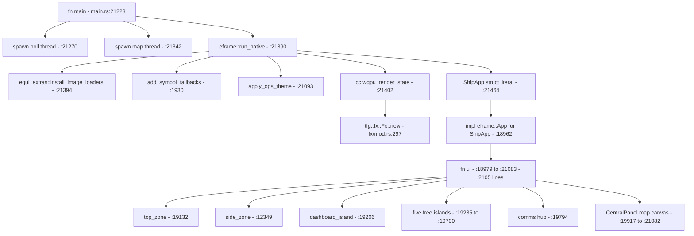
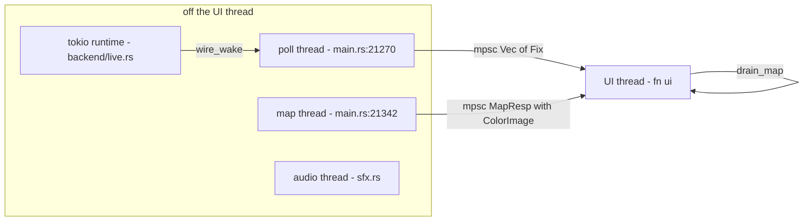
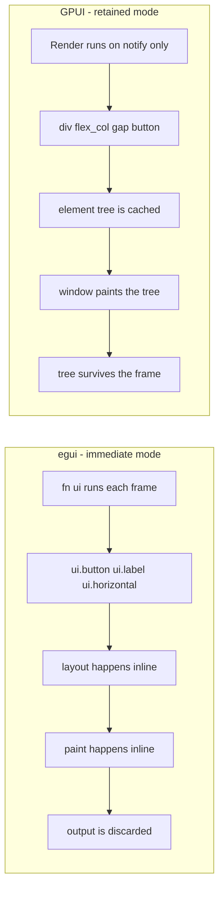
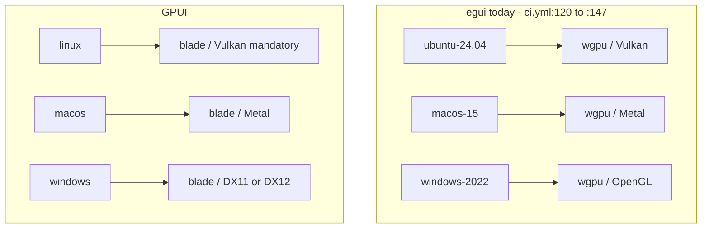
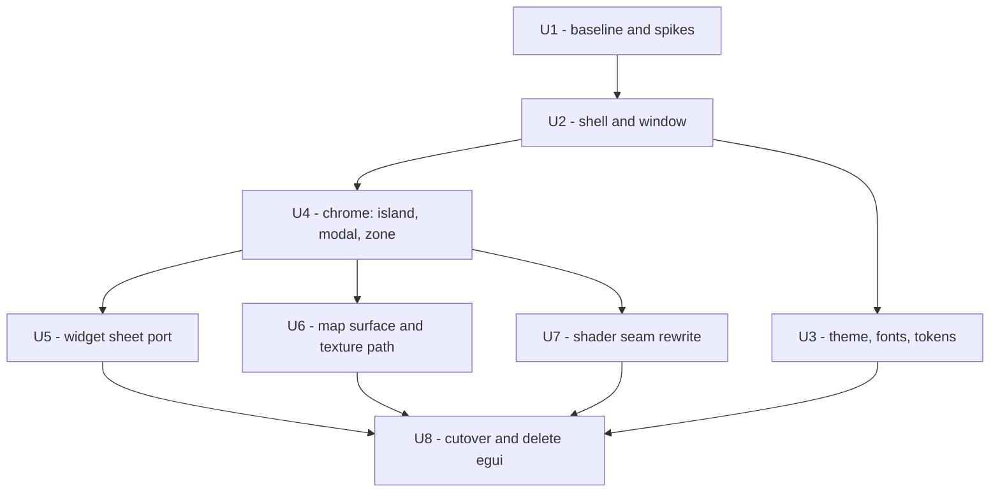

# GPUI migration analysis

**Status:** Analysis. This document makes no decision.
**Date:** 2026-10-10
**Scope:** Move the ARCONS command center client from egui 0.36.2 to GPUI.

## 1. Purpose

This document answers one question: what work is necessary to move the client
from egui to GPUI. It does not recommend the move. It does not reject the move.
It gives the cost, the sequence, and the risks.

The text is in Simplified Technical English (ASD-STE100). Each sentence holds
one instruction or one fact. The verbs are in the active voice. Sentences are
short.

## 2. Sources

The analysis uses measured data from this repository only:

| Item | Size |
|---|---|
| `src/main.rs` | 23,299 lines |
| `src/chrome.rs` | 1,676 lines |
| `src/fx/mod.rs` | 405 lines |
| `src/tokens.rs` | 382 lines |
| `src/camera.rs` | 204 lines |
| `src/gpuprobe.rs` | 187 lines |
| `proto/p5-epaint` | 4,137 lines |
| `scripts/ui-shoot/` | 2,407 lines |
| `docs/adr/0001` to `0018` | 19 decisions |

Six source files carry the whole egui dependency. Six files hold 26,153 lines.

## 3. The current UI layer

### 3.1 Dependency footprint

`Cargo.toml:15` to `Cargo.toml:17` declare three crates:

- `egui = "0.36.2"`
- `eframe = "0.36.2"` - the default features give the wgpu backend
- `egui_extras = { version = "0.36.2", features = ["image", "http"] }`

Nine packages resolve in `Cargo.lock` (lines 1412 to 1621). The `tfg` package
lists three of them directly (`Cargo.lock:5564` to `:5566`).

### 3.2 Application structure

The application is one binary. There is no daemon and no IPC socket.

`impl eframe::App for ShipApp` is at `main.rs:18962` to `:21084`. It has three
functions: `on_exit` (`:18968`), `ui` (`:18979`), and the frame body itself
(`:18979` to `:21083`). The frame body is 2,105 lines. It is the largest
function in the repository.

`impl ShipApp` is at `main.rs:3603` to `:18960`. It holds 15,358 lines and
about 290 methods. About 6,650 of those lines build widgets.

### 3.3 State model

All state is in one struct. `struct ShipApp` is at `main.rs:2737` to `:3583`.
It holds about 250 fields. No field uses serde. The application uses no egui
`Memory` persistence and no settings store.

`main.rs:2799` to `:2802` states the reason in the source. The application has
no storage backend, so all remembered data dies with the process.

Two facts outlive one frame but not the process. Both are in egui temporary
storage. Both are in `chrome.rs`:

- `BodyFit` per island - `chrome.rs:567`, `chrome.rs:647`
- the measured bottom of the top band - `chrome.rs:664`, `chrome.rs:675`

All other state is a plain field, a `HashMap`, or a render cache.

### 3.4 Thread model

The UI thread never starts async work. `main.rs:21` to `:22` states this as a
design rule. Four threads run in the process.

`main()` starts the poll thread and the map thread before `run_native`. The
map thread converts RGBA frames to `egui::ColorImage` away from the UI thread
(`main.rs:21366` to `:21376`).

`pump_rest_ops` (`main.rs:15515` to `:15682`) drains every off-thread result at
the start of each frame. `RestOp::poll` (`:1698`) uses a non-blocking `try_recv`.

### 3.5 Repaint policy

`main.rs:19063` to `:19073` sets the repaint policy:

- if `dirty` is true, or if the camera glides, then `request_repaint()`
- if a REST operation is in flight, then `request_repaint_after(50 ms)`
- if nothing happens, then `request_repaint_after(2 s)` as a watchdog

The two constants are `REST_POLL_REPAINT` (`:467`) and `WATCHDOG_REPAINT`
(`:464`).

### 3.6 Feature inventory

The count is the number of call sites in `src/main.rs`. The count for the
chrome features is the number of call sites in `src/chrome.rs`.

| Feature | Count | Where |
|---|---|---|
| `ui.label` and `ui.weak` | 400 | text output |
| buttons: `small_button`, `ui.button`, `egui::Button` | 141 | actions |
| `RichText` | 126 | styled text |
| `ui.horizontal` | 107 | layout |
| `ui.separator` | 70 | layout |
| `on_hover_text` | 35 | tooltips |
| `ui.selectable_value` | 30 | choice |
| `ComboBox` | 24 | choice |
| `ui.add` | 20 | custom widgets |
| `TextEdit` | 19 | text input |
| `ScrollArea` | 19 (+2 in chrome) | scrolling |
| `request_repaint` | 12 | frame driving |
| `ui.painter` and `painter_at` | 12 | custom paint |
| `egui::Shape` | 12 | custom paint |
| `ui.input` | 15 | raw input |
| `ui.ctx()` | 85 | context access |
| `egui::Window` | 3 | window surface |
| `CentralPanel` | 4 | window surface |
| `egui::Area::new` | 4 (+2 in chrome) | floating surface |
| `ui.columns` | 5 | layout |
| `ui.checkbox` | 9 | choice |
| `ui.collapsing` | 4 | disclosure |
| `Mesh` | 2 | custom paint |
| `egui::Grid` | 1 | calendar |
| `ui.scope_builder` | 1 | layout |
| `ui.allocate_exact_size` | 6 | manual layout |
| `load_texture` and `ColorImage` | 13 | images |
| `Image::` | 8 | images |
| `ctx.copy_text` | 3 | clipboard |
| `set_cursor_icon` | 5 | cursor |
| `ctx.move_to_top` | 2 | layer order |
| `ctx.data` and `data_mut` | 5 (+8 in chrome) | temp storage |
| `egui::Key` | 19 | hotkeys |
| `ctx.egui_wants_keyboard_input` | 1 | focus gate |
| `PaintCallbackInfo` and `CallbackTrait` | 3 | shader seam |
| custom drag (`UnitDrag`, `UnitMoveDrag`) | 1 | drag and drop |
| modals through `chrome::modal` | 5 | modal |
| islands through `chrome::island` | 6 | island |
| egui temporary storage | 4 | all in `chrome.rs` |

### 3.7 The chrome layer

`chrome.rs` is the hardest surface. `chrome.rs:3` to `:11` gives the reason.
`egui::Frame` is the only thing that `egui::Window::frame()` accepts. `Frame`
holds fill, stroke, corner radius, margins and shadow. It has no shape hook.
So a chamfered panel is not possible on a native `Window`. The shell must own
the container.

ADR-0014 records the same limit. ADR-0016 records the rim light rule.

`chrome.rs` gives four containers:

- `island()` - `chrome.rs:336` to `:570`. An `egui::Area` at `Order::Middle`
  with a fixed footprint, a title band, a close button and a body that scrolls.
- `island_owned()` - `chrome.rs:360` to `:570`. The same, but the caller
  supplies input ownership. This gives exactly one lit rim per column.
- `modal()` - `chrome.rs:1050` to `:1214`. A full viewport backdrop at
  `Order::Foreground` and a panel area.
- `side_zone()` - `main.rs:12349` to `:12808`. The island column. It computes
  origins, a chained wheel scroll and one resize grip.

Five behaviours in `chrome.rs` have no direct equivalent in any toolkit. Each
must be rebuilt by hand:

1. The mesh silhouette. `paint_island` (`:136`) paints a polygon with a steel
   bevel. The clip is wider than the panel so the bevel and shadow survive.
2. The fixed footprint. An island does not resize to fit content. The body
   scrolls (`:536` to `:539`).
3. The scroll chain. `BodyFit` (`:587`) publishes content height, viewport
   height and offset. The zone uses these numbers to decide who owns the wheel
   (`main.rs:12616` to `:12661`).
4. The registration order of the title band and the close button. A comment at
   `:489` to `:498` explains it. egui gives a click to the last widget that was
   registered. The close button must come last, and it does.
5. The view transform for drag. `island_owned` reads the previous frame's drag
   before it opens the area (`:374` to `:399`). It clamps the position to the
   viewport only for a drag, not for a computed column position.

### 3.8 The map surface

The map is a `CentralPanel` (`main.rs:19917`) that paints one texture. The map
thread owns a `LiveMap` (MapLibre native). Each frame arrives as RGBA data.
`drain_map` (`main.rs:17189`) uploads the data with `TextureHandle::set`. The
canvas paints it with `egui::Image::from_texture`. The wheel and a pinch drive
the zoom (`main.rs:20568` to `:20608`).

`main.rs:19942` converts the buffer. `main.rs:21367` and `:21372` build the
`ColorImage`.

### 3.9 The shader seam

`fx/mod.rs` borrows a hook inside egui's own render pass.
`egui_wgpu::CallbackTrait` gives three phases: `prepare` before the pass,
`finish_prepare` after all prepares, and `paint` inside the pass. egui submits
the command buffers from `prepare` with its own `queue.submit`.

`Fx::halo` returns a `Shape::Callback` (`fx/mod.rs:315` to `:329`).
`HaloPass` implements `CallbackTrait` (`:351` to `:405`). `build_pipeline`
(`:182`) compiles the one WGSL file.

ADR-0015 records this seam. `Quality` (`fx/mod.rs:57`) gates the shader. The
default is `Low`, which draws nothing.

### 3.10 Typography

egui has no weight axis. `FontId` is `{ size, family }` only. The theme maps
five `TextStyle` variants onto `FontId` (`main.rs:21093` to `:21161`).

The fix that is in the code today: four Inter weights and JetBrains Mono are
registered as separate family names. ADR-0018 records this. `add_symbol_fallbacks`
(`main.rs:1930`) appends `Hack` to the `Proportional` family for four glyph
ranges.

ADR-0018 records two egui font bugs at lines 101 to 106. `set_fonts`
writes definitions into memory. `begin_pass` applies them. A family that is
registered on frame 1 is not bound until frame 2. A paint into that family on
frame 1 causes a panic.

## 4. What GPUI changes

### 4.1 The programming model

egui is immediate mode. The application calls `ui.button(...)` each frame. The
toolkit lays out and paints the result at once.

GPUI is retained mode. Each screen is an `Entity` with a `Render` function.
The `Render` function returns an element tree. The tree is cached. The tree is
rebuilt only when an `Entity` calls `notify()`.

This is the central change. It is not a rename of functions. It is a different
programming model.

Three consequences follow from the change.

**One. State must move into entities.** All state is on one `ShipApp` struct
today. GPUI works best with many small entities. A split of `ShipApp` into
entities is design work. It is not a mechanical port.

A conservative port keeps one entity per island. Each entity owns its own
state. `ShipApp` holds the entities. The `Entity<ShipApp>` pattern is valid in
GPUI, and it is a slower start.

**Two. Values must be immutable or owned.** GPUI entities hold `State`. A plain
`String` field that the UI writes each frame is fine. A field that the UI
mutates in place during layout is not. GPUI forbids it.

**Three. The frame driver is explicit.** egui calls `ui()` at a fixed rate.
GPUI calls `Render` only after `notify()`. The `request_repaint` policy in
`main.rs:19063` to `:19073` becomes a `notify` policy. The 50 ms heartbeat
becomes a timer task that calls `notify()`.

### 4.2 Layout and paint

egui gives a `Ui` with a builder API. GPUI gives a `Style` struct with
`flex_col()`, `flex()`, `gap()`, `padding()` and so on. The mapping is close
but not exact.

| egui | GPUI |
|---|---|
| `ui.horizontal` | `div().flex().flex_row()` |
| `ui.vertical` | `div().flex().flex_col()` |
| `ui.set_min_size` | `.min_w()`, `.min_h()` |
| `ui.set_max_size` | `.max_w()`, `.max_h()` |
| `ui.allocate_exact_size` | `.w(px())`, `.h(px())` |
| `ui.set_clip_rect` | `.overflow_hidden()` or a parent clip |
| `ScrollArea` | `div().overflow_y_scroll()` or a virtual list |
| `ui.painter()` | `window.paint_quad()`, `paint_path()`, `custom Paint` |
| `egui::Shape` | `paint_quad`, `paint_path`, `paint_line` |
| `Mesh` | `window.paint_vertices` or a custom element |
| `RichText` | `.text_color()`, `.font_weight()`, custom `Stylize` |
| `Frame` | `div().bg()`, `.border()`, `.rounded()` |
| `CornerRadius` | `.rounded()` with `Corners` |

The largest gap: egui's `set_clip_rect` is a raw rect with no rules. GPUI
clips through the element tree. The chrome's wider-than-panel clip
(`chrome.rs:434`) is not a direct port. It needs a parent container with a
corner radius, or a custom element that paints past its own bounds.

### 4.3 Typography

GPUI has a real font stack. `Font` has `family`, `weight`, `style`, `features`
and `fallbacks`. Weight is a first-class value.

This is a real win. `apply_ops_theme` (`main.rs:21093`) and the four separate
Inter family names can collapse into one family with four weights. The
`add_symbol_fallbacks` hack (`main.rs:1930`) becomes a real fallback chain.

That is a cleanup, not a port. It is optional work.

### 4.4 Text measurement and the fixed footprint

An island has a fixed footprint today. The body scrolls. GPUI supports this
with `.min_w()`, `.min_h()` and `overflow_y_scroll()`.

`BodyFit` (`chrome.rs:587`) has no GPUI equivalent. GPUI gives no measurement
of scroll offset to a sibling element. A custom element that reports its scroll
state is necessary. This is the single hardest part of the chrome port.

### 4.5 The map surface

The map thread already builds frames away from the UI thread. That thread
model moves without change.

`egui::ColorImage` and `TextureHandle::set` become an `Arc<Image>` or an
`ImageSource`. GPUI caches images by URI. A frame that arrives every 50 ms
must use a new URI for each frame, or a custom element that draws the texture
directly from the GPU side.

This is a design point. A naive port uploads 50 textures per second.

### 4.6 The shader seam

egui exposes `egui_wgpu::CallbackTrait` as an official hook. GPUI exposes
`Surface` and a `PaintSurface` callback. The two are not the same shape.

`Fx::halo` becomes a custom element that renders to a GPUI surface. You must
write the WGSL for the surface's pipeline. `fx/mod.rs:182` to `:405` is a full
rewrite, not a port.

This is a small file (405 lines), but it is GPU work with no quick test.

### 4.7 Platform and rendering

ADR-0018 measured the platform. Four facts block a clean port:

- `cargo add gpui` pulls 707 locked packages. The build fails in `xattr-0.2.3`
  on `ENOATTR` until a `[patch.crates-io]` line is added. With the patch, the
  build takes 520 crates and 3.1 GB of target. egui is one crate.
- `blade-graphics` makes Vulkan a hard requirement whenever the x11 or wayland
  feature is on.
- `gpui_platform`, which `main` requires, is not on crates.io.
- GPUI renders no frames under the project's Xvfb. The published
  `hello_world` creates two 1x1 helper windows that never map, and it idles in
  `epoll_wait`. The log line is
  `MESA: info: vulkan: No DRI3 support detected - required for presentation`.

The last fact is the largest risk. The project's whole verification method is
`screenshot the window on Xvfb`. If GPUI does not render there, the
verification method dies with it.

### 4.8 The build and CI matrix

egui targets three OSes with three backends. GPUI targets the same three OSes
through different backends.

CI runs `tfg --probe-gpu` with `continue-on-error: true` (`ci.yml:337` to
`:339`). That pattern must continue. A CI runner may have no GPU.

`libvulkan1` is already a runtime dependency in the package
(`ci.yml:630` to `:646`). It is not a new requirement. egui needs it today for
its wgpu backend.

This is good news for the platform risk. The Linux runtime already carries
Vulkan, so GPUI's mandatory Vulkan costs nothing new in packaging.

## 5. Work breakdown

The work falls into seven units. Each unit is independently testable.

### U1 - Baseline and spikes (2 to 3 weeks)

No production code changes. This unit proves the platform works before any
port starts.

- Add GPUI to a scratch crate. Add the `[patch.crates-io] xattr` line.
- Get `hello_world` to render a real frame on the project's Xvfb. If it does
  not, the whole migration stops here. Use lavapipe, or change the capture
  environment, or use a real GPU.
- Measure the effective dependency tree and the build time.
- Decide the image source strategy for the map (URI churn versus a custom
  element).
- Decide the scroll-measurement strategy for `BodyFit`.

`proto/` is the right place for this. The prototype crate already isolates the
shell from MapLibre.

### U2 - Shell and window (1 to 2 weeks)

- `Application::new().with_assets()` and a first window.
- `ViewportBuilder` becomes a `WindowOptions` (title, inner size, position).
- `eframe::run_native` becomes `run()` with a `Box<dyn FnOnce>`.
- One `Entity` with one `Render` that paints one label.
- Wire the existing `main()` threads to the new shell. Keep the threads as
  they are. Keep the `mpsc` channels as they are.
- Port `on_exit` (`main.rs:18968`) to GPUI's `on_should_quit`.

This unit is small and mechanical. It is the only easy unit.

### U3 - Theme, fonts, tokens (2 to 3 weeks)

`tokens.rs` is 382 lines. It already holds no egui types except
`egui::Color32` and `egui::Vec2` (line 27). Convert those to GPUI colors and
sizes first.

Then port `apply_ops_theme` (`main.rs:21093` to `:21161`). All 22 values in it
come from `tokens`. The mapping is direct: `Visuals` becomes a GPUI theme,
`spacing` becomes `Style`.

Then register the fonts. Add the real Inter weights. Decide whether to keep the
four-family workaround or collapse to one family with four weights. Collapsing
is better, and it is optional.

Do not skip the `add_symbol_ffallbacks` glyphs. Four ranges need a fallback:
`U+2192`, `U+2190`, `U+25B8`, `U+25CF`, `U+221A`.

### U4 - Chrome: island, modal, zone (4 to 6 weeks)

This is the largest risk unit. 1,676 lines in `chrome.rs` plus 473 lines of
`side_zone` (`main.rs:12349`).

Port in this order. Each step keeps the build green.

1. `paint_island` (`chrome.rs:136`) and `paint_rim` (`:220`) as a custom
   element. The chamfered silhouette becomes a `paint_path`. The steel bevel
   becomes three quads. This is a full rewrite of the paint, not a port.
2. The band texture (`paint_band_texture`, `:236`). This is a texture fill.
   Decide the GPUI image strategy here.
3. The title band, `tracked_caps` (`:258`), the close button (`:291`) and the
   drag interact. GPUI gives `on_mouse_down` and `on_click`. Build a custom
   element that owns the band.
4. `BodyFit` (`:587`) and the scroll chain (`main.rs:12616` to `:12661`). This
   needs a custom element that reports its own scroll state. This is the
   hardest single piece in the whole migration.
5. `modal()` (`:1050` to `:1214`) with the backdrop at `Order::Foreground`.
   GPUI's `Order` equivalent is layer management. ADR-0016's "one lit rim"
   rule (`owning_island`) must be re-expressed.
6. `side_zone()` (`main.rs:12349`) - origins, band, the chained wheel, the
   resize grip, the `move_to_top` call.

The 27 tests in `chrome.rs` are geometry tests. They port well if you make the
geometry functions pure first. Do that before step 1.

### U5 - Widget sheet port (6 to 10 weeks)

About 6,650 lines in `impl ShipApp` build widgets. About 290 methods. Port in
this order. Each step keeps the build green.

1. Text: `ui.label` (258), `ui.weak` (142), `RichText` (126). Straight mapping.
2. Buttons: `small_button` (99), `ui.button` (14), `egui::Button` (28).
3. Layout: `ui.horizontal` (107), `ui.vertical` (6), `ui.columns` (5),
   `ui.separator` (70), `scope_builder` (1).
4. Choice: `ComboBox` (24), `selectable_value` (30), `checkbox` (9),
   `collapsing` (4), `toggle_value` (1).
5. Input: `TextEdit` (19) with all its variants - singleline, multiline,
   password, hint text, id, frame none, vertical align.
6. Lists and tables: the Miller columns (`miller_rows_ui`, `main.rs:9810`,
   290 lines) and `egui::Grid` (`main.rs:9153`). GPUI has a virtual list. Use
   it for the Miller columns.
7. Tooltips: `on_hover_text` (35 sites).
8. Custom drag: `UnitDrag`, `UnitMoveDrag` (`main.rs:2521` to `:2544`),
   `update_unit_drag` (`:16926`), `finish_unit_move` (`:17052`). GPUI gives
   mouse events. Build a drag state machine on a custom element.
9. The two remaining `egui::Window` surfaces: Settings (`main.rs:11165`) and
   the Presentation card (`main.rs:19140`).

Then the 15 custom painters in `main.rs` - `paint_gradient` (`:725`),
`regular_polygon` (`:815`), `paint_group_symbol` (`:900`),
`paint_affiliation_frame` (`:1034`), `paint_affiliation_tint` (`:1186`),
`paint_map_symbol` (`:1298`), `paint_unit_image` (`:1551`) and the rest. These
are pure paint, and they are the most mechanical part.

### U6 - Map surface and texture path (2 to 3 weeks)

- Replace `egui::ColorImage` and `TextureHandle::set` (`main.rs:17194`).
- Replace `egui::Image::from_texture` (`main.rs:19946`) in the `CentralPanel`.
- Replace `egui_extras::install_image_loaders` and the five
  `try_load_texture` sites (`:9684`, `:12949`, `:16851`, `:16913`, and the
  manifest). egui_extras loads over HTTP. GPUI has no HTTP image loader. Write
  one, or reuse `reqwest` which is already a dependency.
- Replace `egui::load::SizedTexture` (`:2111`, `:2438`).
- Keep the map thread exactly as it is. Only the handoff changes.

### U7 - Shader seam rewrite (2 to 4 weeks)

`fx/mod.rs` is 405 lines. All of it is wgpu work through an egui hook. None of
it ports directly.

- Rewrite `build_pipeline` (`:182`) for a GPUI surface.
- `HaloPass` (`:351`) becomes a custom element or a surface render callback.
- `Fx::halo` (`:315` to `:329`) becomes a `Shape` in GPUI's terms.
- Keep `Quality` (`:57`) and `from_device_type` (`:73`). They are plain logic.
- Keep the WGSL if the pipeline format allows. GPUI uses wgpu 0.19 or newer.
  Check the WGSL syntax against that version.

ADR-0015 records the seam. Read it before this unit.

### U8 - Cutover (2 to 3 weeks)

- Move the 53 tests in `main.rs` off `egui::Context::default()`
  (`main.rs:22453`).
- Remove `egui`, `eframe` and `egui_extras` from `Cargo.toml`.
- Delete `proto/p5-epaint` (4,137 lines) and `scripts/run-egui-window.sh`.
- Rebuild `scripts/ui-shoot/`. The XTEST driver (`xdrv.c`) still works. The
  button-finding (`find-buttons.py`) walks the widget tree by pixel, so it
  still works. `verify-scroll.sh` (452 lines, 17 assertions per frame) must be
  re-recorded.
- Update `.github/workflows/ci.yml`. Add the `[patch.crates-io] xattr` line to
  the build, or vendor `xattr`. Update the package `Depends` line
  (`ci.yml:630`) and `about.toml` for the new license set.
- Write the ADR. This analysis is not the ADR.

## 6. Effort estimate

The estimate assumes one engineer who knows this repository.

```mermaid
gantt
    title GPUI migration - week ranges
    dateFormat X
    axisFormat %s weeks
    section Stop or go
    U1 baseline and spikes      :u1, 0, 3w
    section Shell
    U2 shell and window         :u2, after u1, 2w
    U3 theme fonts tokens       :u3, after u2, 3w
    section Critical path
    U4 chrome island modal zone :u4, after u3, 6w
    U5 widget sheet port        :u5, after u4, 10w
    U6 map surface and textures :u6, after u4, 3w
    U7 shader seam rewrite      :u7, after u4, 4w
    section Cutover
    U8 cutover and delete egui  :u8, after u5, 3w
```

The table gives the arithmetic.

| Unit | Range | Note |
|---|---|---|
| U1 spike | 2 to 3 weeks | can stop the whole project |
| U2 shell | 1 to 2 weeks | mechanical |
| U3 theme and fonts | 2 to 3 weeks | direct mapping |
| U4 chrome | 4 to 6 weeks | highest risk |
| U5 widget sheet | 6 to 10 weeks | largest volume |
| U6 map and textures | 2 to 3 weeks | needs a design decision |
| U7 shader | 2 to 4 weeks | no quick test |
| U8 cutover | 2 to 3 weeks | includes CI and packaging |
| **Total** | **21 to 34 weeks** | **5 to 8 months** |

Volume for comparison:

- Total egui-touching code: 26,153 lines.
- Code that is a direct rename: maybe 40 percent.
- Code that needs a redesign: `chrome.rs`, `fx/mod.rs`, the texture path, and
  the entity split. That is about 3,000 lines, but it is the critical path.

A mechanical find-and-replace estimate is false. The retained-mode change is
the cost, not the API surface.

## 7. Risk register

| Risk | Effect | Mitigation |
|---|---|---|
| GPUI does not render on the project's Xvfb | The whole verification method dies. This is a stop condition. | Prove it in U1 before any port. |
| `gpui_platform` is not on crates.io | `main` cannot be pulled as a library dependency. | Use the published `gpui` 0.2.2 only. Do not use `main`. |
| `xattr` fails to build | A dirty build blocks CI. | Add `[patch.crates-io]` in U1, and record it. |
| Vulkan becomes mandatory | CI runners without Vulkan fail. | Keep `continue-on-error` on the probe step. |
| 3.1 GB of target | Build time and disk grow a lot. | Measure in U1. |
| Retained-mode rewrite of `ShipApp` | The design cost is under-estimated. | Keep one entity at first. Refactor later. |
| `BodyFit` has no equivalent | The scroll chain breaks. | Build a measuring element. Test it first. |
| Two `Window` surfaces and five modals | Modal stack behavior changes. | Port `chrome::modal` in one step. |
| Windows moves from OpenGL to DirectX | A second backend to test. | Test the Windows build in U1. |
| New license set from 707 packages | Legal review needed. | Regenerate `about.toml` in U8. |
| No `Memory` persistence | Nothing is lost. | None. |
| Map frame upload at 50 Hz | Texture churn and memory growth. | Design the image source in U1. |

## 8. What does not change

A large part of the repository is untouched. This is the good news.

- 18,717 lines of domain code hold no egui types: `geo/`, `symbology/`,
  `sim.rs`, `command.rs`, `gamestate.rs`, `groups/`, `force.rs`, `book.rs`,
  `roster.rs`, `fleet.rs`, `catalog.rs`, `log.rs`, `clock.rs`, `store.rs`,
  `backend/`. None of this needs a change.
- The thread model does not change. The UI thread still never starts async
  work. `main.rs:21` to `:22` stays true.
- The `mpsc` channels do not change.
- `pump_rest_ops` (`main.rs:15515`) does not change. It is a pure function of
  the channel.
- `map_render.rs` does not change. It only feeds the texture.
- `symbology/` does not change. ADR-0001 keeps the map engine pure.
- `store.rs` and the local-first model do not change.

The migration is 26,153 lines of surface over 18,717 lines of domain. The
surface is the work. The domain is stable.

## 9. Recommendation

Do the U1 spike first, on its own, with no commitment. The spike is three days
of work. It answers the one question that decides the project:

Does GPUI render a real frame on the project's capture environment?

- If the answer is yes, then the 5 to 8 month estimate is real, and the
  decision is a normal engineering trade.
- If the answer is no, then the project must also change its verification
  environment. That is a second, hidden cost that ADR-0018 did not price.

Do the spike before you approve any port work. ADR-0018 already measured a
negative result on this question. A new measurement is the correct next step.
The full U1 unit (2 to 3 weeks) covers the spike, the dependency measurement,
and the two design decisions listed in section 5.

## 10. Terms

| Term | Meaning |
|---|---|
| egui | The immediate mode GUI library used today. |
| eframe | The egui application shell and window layer. |
| epaint | The egui paint and text layer. |
| GPUI | The retained mode GUI library used by Zed. |
| Blade | The graphics layer that GPUI uses. |
| Immediate mode | The UI code runs each frame and builds the layout inline. |
| Retained mode | The UI code builds a cached tree. The tree is rebuilt only on notify. |
| ASD-STE100 | Simplified Technical English, a controlled writing standard. |
